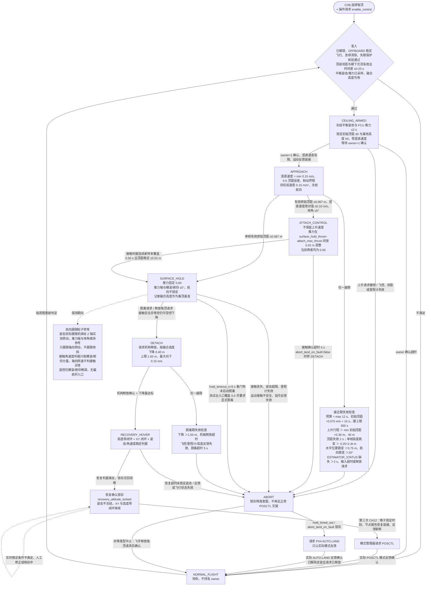
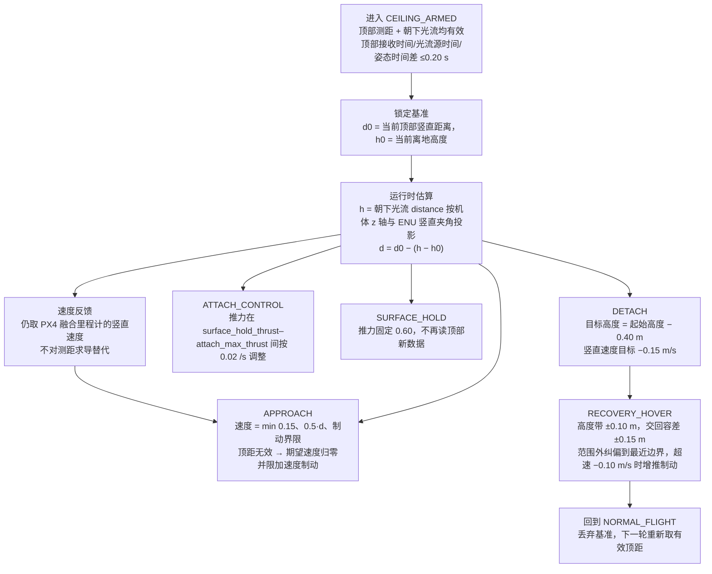

# 吸顶行为（顶吸）

本文是吸顶行为的唯一说明，覆盖入口差异、状态阶段、顶距来源、门限、失效保护和
遥控确认。参数以 `config/ceiling_attachment.yaml`、launch 覆盖和运行时配置为准，
本文数值仅为当前默认值的快照。脱离、恢复与自动降落分支见 [behaviors](behaviors.md)；
两篇合并后的完整流程图见第 8 节。

- 决策：`scripts/decisions/ceiling_attachment_decision_node.py`
- 运动反馈适配：`src/px4_wall_ceiling_control/adapters/ceiling_motion.py`
- 运动包络：`src/px4_wall_ceiling_control/domain/ceiling_motion.py`
- 最终输出：`scripts/outputs/attachment_output_mux_node.py`

## 1. 入口差异

| 入口 | 飞行模式 | 关键覆盖 | 用途 |
|---|---|---|---|
| `launch/system/attachment_terminal_flight.launch` | 吸顶 `POSCTL`、侧吸 `ALTCTL` | `flight_enabled` 默认 `false` | 终端/CH12 入口，见 [terminal](terminal.md) |
| `launch/system/wall_console_flight.launch` | 吸顶与侧吸均 `POSCTL` | `hold_timeout_s=0`、`hold_require_explicit_detach=true`、融合高度、`surface_hold_thrust=0.60`、默认下降 0.40 m | 测试台入口，见 [console](console.md) |

两个入口共用同一套吸顶链路。`attachment_terminal_flight.launch` 之外不再有独立的
吸顶台架入口。

## 2. 状态阶段

```text
PRESTREAM -> ENTERING -> OFFBOARD 实反馈
  -> CEILING_ARMED -> APPROACH -> ATTACH_CONTROL -> SURFACE_HOLD
  -> DETACH -> RECOVERY_HOVER -> 锁定恢复姿态 -> 第三次 CH12 -> 实际 POSCTL 确认
```

`CeilingAttachmentStatus.STATE_*` 编号保持不变，`ABORT=7` 是统一中止阶段（原
`FAULT` 编号），没有独立的编号 8。完整流程、失效分支与交回约定见第 8 节。

| 阶段 | 进入条件 | 主要行为 |
|---|---|---|
| `CEILING_ARMED` | 已在目标模式稳定飞行、已解锁、急停清除、失联保护核验通过、平衡姿态与推力已采样 | 冻结平衡姿态与 FCU 推力最多 2 s；锁定初始顶距 `d0` 与离地高度 `h0`；零竖直速度等待 |
| `APPROACH` | 顶距准入、运动反馈有效、未暂停 | 上升速度目标 = min(最大速度、距离比例目标、制动界限)，当前最大 `0.15 m/s`、比例 `0.5 /s`、目标加速度 `0.15 m/s²`；冻结航向，弱位置环 + 水平速度 PI |
| `ATTACH_CONTROL` | 有效原始顶距 ≤ 0.067 m，竖直速度绝对值 ≤ 0.10 m/s，总倾角 ≤ 5° 且反馈有效 | 不保留主动上升速度；推力在 `[surface_hold_thrust, attach_max_thrust]` 之间按 `0.02 /s` 调整（当前 0.60 / 0.60） |
| `SURFACE_HOLD` | 接触判据连续新样本覆盖 0.5 s | 推力固定 `surface_hold_thrust`；推力轴与横滚/俯仰保持在 ≤5° 包络内，**航向不锁定**：姿态目标跟随机体绕机体 Z 轴的实测转动，轮子带动机体转弯时控制器不去拉回旧航向；HOLD 的接触角速度判据只取横滚/俯仰分量，轴向转速不判为接触异常；记录融合高度作为离顶基准 |
| `DETACH` | 脱离命令、取消、接触失败或接触安全条件失效 | 请求机构释放（当前无回执）；按融合高度下降（0.40 m，上限 1.50 m），最大向下 `0.15 m/s`，超时 YAML 5 s / 测试台入口 20 s |
| `RECOVERY_HOVER` | 下降量达标 | 高度闭环 + 水平/姿态稳定判据；稳定后锁定实测姿态，高度闭环继续 |
| `NORMAL_FLIGHT` | 锁定后收到晚于锁定时刻的第三次有效 CH12 | 请求 `POSCTL`，以飞控实际模式反馈确认交回 |

单帧有效原始顶距 ≤ `0.067 m` 时可直接从 `APPROACH` 进入 `SURFACE_HOLD`，
不经过接触渐增推力阶段。同一决策周期内的合格帧保留到处理或测距超时，
后续偏大帧不会吞掉触发。

## 3. 顶距来源（唯一链路）

吸顶只保留“接管时锁定的顶部基准 + 朝下光流升高量”这一条链路：

- 进入 `CEILING_ARMED` 时要求有效顶部测距与有效朝下光流测距；顶部接收时间与光流
  源时间差、光流与姿态时间差均不得超过 0.20 s。
- 使用 `/mavros/px4flow/raw/optical_flow_rad.distance` 按机体 z 轴与 ENU 竖直夹角
  投影得到离地高度 `h`；剩余顶部竖直距离 `d = d0 - (h - h0)`。
- 基准锁定后，顶部新数据与顶部健康状态不再参与本轮距离控制，也不能重写基准。
- 内层速度反馈仍取 PX4 融合里程计竖直速度，不对测距求导替代速度反馈。
- 回到 `NORMAL_FLIGHT` 后丢弃基准，下一轮必须重新取得有效顶部测距。

兼容说明：消息字段 `ceiling_distance_raw_m` / `ceiling_distance_filtered_m` 在此链路
承载的是**基准估算的轴向顶部距离**，不是顶部雷达实测值；`reason` 会注明来源。
该估算依赖静止、连续的平面地面与天花板，地面斜坡、顶部高度变化或基准误差都会
影响距离，不能独立证明实体接触、吸附或压缩量。

## 4. 时间、行程与失效保护

- 任务预算 `max(原 12 s, 初始竖直顶距/(0.5×最大上升速度)+接触超时 5 s+裕量 5 s)`，
  硬上限 `300 s`；总时间不因顶距丢失而冻结。
- 相对初始高度上升行程上限 `min(初始竖直顶距+0.30 m, 40 m)`，超过即中止；40 m 是
  软件上限，不代表光流有效量程。
- 顶距无效立即把期望上升速度降为 0 并按加速度限制制动，持续不可用 2 s 中止；
  传感器本身还有 0.60 s 新鲜度判定。
- 单帧高度变化超过 `0.25 + 2·dt` 米时锁存基准异常并中止；估算已越过锁定天花板
  平面时直接中止。
- 自由飞行阶段反馈无效即暂停竖直运动并清除水平积分，需连续 0.30 s 新样本才恢复；
  漂移、实测倾角或角速度超限确认 0.20 s 后暂停，恢复阈值连续 0.50 s 后解除。
- 位置相邻样本跳变超过 `0.75 m + 当前速度可解释位移`、或航向跳变超过 20°，
  本轮锁存中止；源时间异常不能用接收时间刷新掩盖。

## 5. 保持阶段的超时与自动降落

- 默认配置 `hold_timeout_s=5.0`：进入保持 5 s 仍未启动脱离则锁存中止并请求机构释放，
  模式管理器进入降落分支请求 `AUTO.LAND`；同一周期已有脱离/取消请求时优先正常脱离。
- 只有测试台入口 `wall_console_flight.launch` 把它覆盖为 `0.0` 并启用
  `hold_require_explicit_detach=true`：保持阶段不按时长自动脱离，必须显式请求。
- 终端入口 `attachment_terminal_flight.launch` 沿用 YAML 的 5.0 s 看门狗，即终端实飞时
  超过 5 s 未脱离会自动请求降落；若不需要该行为，需在启动前显式设置
  `/ceiling_attachment_decision_node/hold_timeout_s`。
- 接触安全异常（接触丢失、姿态超限、里程计失效等）优先进入中止，优先级高于同一
  周期的正常脱离请求；脱离下降、恢复悬停和接管上升中的中止同样锁存降落意图。
- 中止后不再转回正常 `POSCTL` 交接；只有新的实际 `AUTO.LAND` 模式反馈才确认降落
  已开始。USB 拔出后降落意图保持锁存，重连后继续处理。
- `abort_land_on_fault`、`ekf_abort_guard_enabled` 当前均为 `true`；磁创新比异常
  通过 `/mavlink/from` 的 `ESTIMATOR_STATUS` 判断，缺失超过 2 s 会阻止准入或使
  运行中的动作中止。
- 急停、确认解除武装和飞手明确改变模式保留最高优先级。

## 6. 恢复与 CH12 交回

- 恢复阶段高度参考固定，范围内竖直目标速度为 0，速度 PI 与推力补偿继续；范围外
  纠偏到最近边界。控制容差与交回容差分离：`recovery_height_tolerance_m=0.10`，
  `recovery_handover_height_tolerance_m=0.15`。
- 恢复确认锁存后**不冻结姿态**，也不关闭 XY 位置/速度闭环；允许受限遥控横滚/俯仰
  修正，禁止油门直接控制高度。`recovery_attitude_locked` 保留旧名字，实际只表示
  恢复确认与 CH12 时间门槛已锁存。
- 只有本轮新鲜、有效、健康的恢复反馈才允许重设 XY 参考；反馈过期或安全暂停时保留
  最后参考。人工修正与制动期间不接受 CH12 交回。
- 实际 ENU 竖直速度小于 `-0.10 m/s` 时取消继续下降目标并增加推力制动，制动推力
  下限不被历史负积分抵消。
- 第三次 CH12 必须在锁定后、节点仍报告恢复就绪且反馈新鲜时触发；提前拨动不排队，
  高位不重复触发，`CH8` 只选择下一轮任务，旧确认不能跨轮复用。等待确认不按时长结束。

## 7. 遥控修正

- 自由飞行每轴 ±5°、变化率 10°/s，最终总倾角 ≤10°；接触保持每轴 ±2°、总倾角 ≤5°。
  没有遥控偏航杆入口：偏航不参与修正，`SURFACE_HOLD` 期间航向跟随机体绕 Z 轴的实测
  转动（见第 2 节与第 8 节），其余阶段保持捕获航向参考。
- 输出端仅在真正发布吸顶候选后发 `/attachment/ceiling_rc_assist`，携带动作标识、
  候选序号、阶段与源时间；决策端拒绝过期、未来、错轮次、错阶段和倒序反馈。
- 人工拨杆或残余修正超过 0.05° 时清除并暂停水平积分，位置回拉权重平滑降至 0.25；
  回中后恢复 1，`rc_manual_blend_s=0.50`。原 x/y 参考不变，不能靠连续拨杆移动允许范围。
- 漂移 ≥0.30 m 或运动暂停时保持完整位置回拉；0.50 m 暂停阈值与姿态/角速度保护继续生效。
- 修正反馈接收与源时间均要求 ≤0.20 s；缺失时恢复完整回拉、暂停积分并禁止确认稳定。

## 8. 逻辑流程图

下图把本文的入口、状态阶段、顶距来源、失效保护与 CH12 交回，与
[behaviors](behaviors.md) 的脱离、恢复悬停、异常续接和自动降落分支合并成一条完整
链路。图中数值取自 `config/ceiling_attachment.yaml` 与两个 launch 入口的当前覆盖；
测试台入口的差异单独标出。

### 8.1 状态机主流程



### 8.2 顶距来源与竖直控制分层



### 8.3 中止、交回与状态约定

- `SURFACE_HOLD` 允许机体在轮子驱动下转弯：姿态目标只跟随实测的绕机体 Z 轴转动，
  推力轴与倾角仍留在接触包络内（`contact_max_tilt_deg=5°`），倾角与轴变化率限制不变；
  跟随只发生在 HOLD，接触确认、接近、脱离、恢复仍按原角速度判据。同步后的航向供
  `DETACH` 规划使用，因此转弯后脱离不会先回到接管时的旧航向。
- `ABORT=7` 是统一中止阶段，没有独立编号 8。中止后不转回正常 `POSCTL` 交接：
  `hold_timed_out` 或 `abort_land_on_fault` 一旦锁存，只等实际 `AUTO.LAND` 模式反馈
  或解除武装并释放请求；USB 拔出后降落意图保持锁存。
- 接触安全异常优先于同一周期的正常脱离请求；脱离下降、恢复悬停和接管上升中的中止
  同样锁存降落意图。急停、确认解除武装与飞手明确改变模式优先级最高。
- `recovery_attitude_locked` 是旧名字，实际只表示恢复确认与 CH12 时间门槛已锁存；
  姿态不冻结，XY 位置/速度闭环继续，人工修正与制动期间不接受 CH12 交回。
- 提前拨动 CH12 在高位不重复触发，`CH8` 只选择下一轮任务，旧确认不能跨轮复用；
  等待确认不按时长结束。
- 顶距消息字段 `ceiling_distance_raw_m` / `ceiling_distance_filtered_m` 承载的是基准
  估算的轴向顶部距离，不是雷达实测值；参数与模式确认都不能证明实体接触或吸附成功。

## 9. 参数速查

| 参数 | 当前值 | 说明 |
|---|---:|---|
| `hover_thrust` | 0.49 | 由 launch 覆盖三处 YAML |
| `approach_speed_mps` | 0.15 | 最大上升速度 |
| `approach_distance_kp` | 0.50 | 顶距误差 → 速度，1/s |
| `approach_max_duration_s` / `approach_max_ascent_m` | 300 / 40 | 任务时间与行程硬上限 |
| `approach_timeout_s` | 12.0 | 接近预算下限，与 `approach_max_duration_s` 取较小值 |
| `stable_tolerance_m` | 0.02 | 接触稳定距离容差 |
| `attach_max_thrust` / `surface_hold_thrust` / `max_thrust` | 0.60 / 0.60 / 0.90 | 接触上限 / 保持 / 总上限 |
| `hold_timeout_s` | 5.0（测试台入口覆盖 0.0） | 保持自动降落看门狗 |
| `detach_drop_m` / `detach_max_drop_m` | 0.40 / 1.50 | 下降目标 / 上限 |
| `detach_timeout_s` | 5.0（测试台入口 20.0） | 脱离超时 |
| `abort_land_on_fault` / `ekf_abort_guard_enabled` | true / true | 中止降落与磁安全门 |

## 10. 尚未验证

- 接触距离、压缩量与脱离推力仍需真实机架确认；无独立吸附机构时必须实测接触阈值，
  否则可能永远无法确认贴顶。
- 融合高度与竖直速度来自 PX4 估计；估计跳变、传感器外参和地面平整度都会影响结果。
- 上方飞行器姿态估计是否满足 5°/10° 包络，需要在 SITL/受控台架与实飞记录中确认。
- 误把 ROS 侧融合输出当作 PX4 实际融合了现场传感器是常见错误，需用 ULog 核实。
