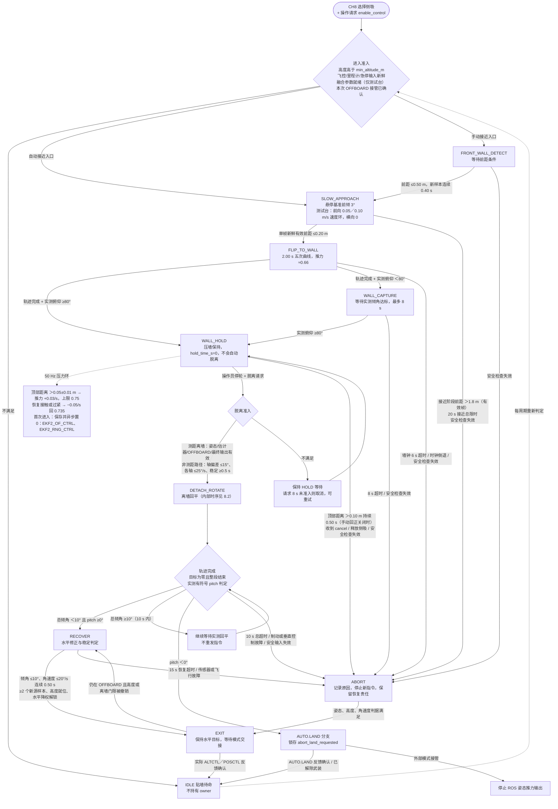
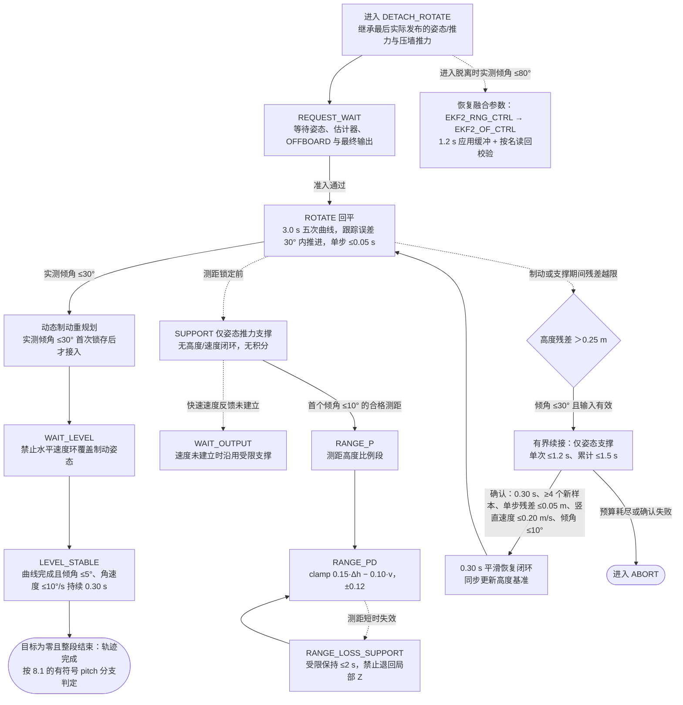

# 侧吸行为（贴墙）

本文是侧吸行为的唯一说明，覆盖前距触发、翻转门限、压墙保持、水平速度环、融合参数
切换与脱离恢复入口。脱离后的分支策略见 [behaviors](behaviors.md)；两篇合并后的完整
流程图见第 8 节。

- 决策：`scripts/decisions/wall_perch_decision_node.py`
- 融合参数管理：`scripts/sensors/wall_sensor_fusion_manager_node.py`
- 水平速度适配：`src/px4_wall_ceiling_control/adapters/wall_horizontal_velocity.py`
- 脱离垂直控制：`src/px4_wall_ceiling_control/adapters/wall_detach_vertical.py`

## 1. 状态顺序

```text
IDLE -> FRONT_WALL_DETECT -> SLOW_APPROACH -> FLIP_TO_WALL
     -> WALL_CAPTURE -> WALL_HOLD -> DETACH_ROTATE -> RECOVER -> EXIT -> IDLE
```

任何执行状态释放侧吸请求、收到 `/wall_perch/cancel` 或触发安全检查，都会进入
`ABORT -> EXIT -> IDLE`。完成一次动作后必须先释放请求才能再次启动，避免高电平
自动重复翻转。`/wall_perch/cancel` 在本包内已无发布者，取消由
`/attachment/terminal_command "cancel"` 经操作门转换成 `OperatorCommand` 实现。

## 2. 入口差异

| 入口 | 侧吸交回模式 | 关键覆盖 |
|---|---|---|
| `launch/system/attachment_terminal_flight.launch` | `ALTCTL`（`wall_pilot_mode` 默认值） | 正常脱离完成、owner 释放后请求 `ALTCTL` |
| `launch/system/wall_console_flight.launch` | `POSCTL` | 启用测距离墙高度环、水平速度环、融合参数切换、动态制动 |

两份 YAML 默认关闭的功能（`detach_range_height_enabled`、`horizontal_velocity_enabled`、
`wall_sensor_fusion_enabled`）只由测试台入口打开，终端入口保持简化链路。

## 3. 接近与翻转门限

| 条件 | 当前值 | 说明 |
|---|---:|---|
| `front_ready_distance_m` | 0.50 | 前向原始距离不大于此值 |
| `front_ready_hold_s` | 0.40 | 需不同新测量样本连续确认 |
| `flip_trigger_distance_m` | 0.20 | 单帧新鲜有效原始前距即可翻转 |
| `flip_trigger_hold_s` | 0.0 | 不等待滤波或连续确认 |
| `approach_abort_front_distance_m` | 1.8 | 前距超此值中止翻转前接近 |
| `approach_timeout_s` | 20.0 | 接近总时限，含等待 |
| `flip_time_s` | 2.00 | 翻转轨迹累计时间 |
| `flip_duration_timeout_s` | 6.00 | 翻转阶段独立墙钟超时 |
| `capture_timeout_s` | 8.00 | 捕获等待上限 |
| `hold_entry_min_pitch_deg` | 80.0 | 实测俯仰角准入 |

- 前距 ≤0.50 m 并由新样本连续确认 0.40 s 后直接进入 `SLOW_APPROACH`，不经
  `STABILIZE_HOVER`（`stabilize_time_s=0`）。慢速接近从一开始就以悬停姿态为基准向墙倾斜 3°。
- 进入 `FLIP_TO_WALL` 后不再要求前向雷达新鲜，也不再用其距离做状态或故障判定；
  顶部雷达与飞行状态的安全检查保持有效。
- 翻转完成必须以累计轨迹时间 + 新鲜里程计实测俯仰角共同判断，不能只看命令角或墙钟。
  实测俯仰角 ≥80° 直接进入 `WALL_HOLD`，否则进入 `WALL_CAPTURE` 等待，
  逾期先中止，即使当周期恰好达标也不再准入。
- 直接 `FLIP_TO_WALL -> WALL_HOLD` 时保留该时刻姿态目标，避免跳到完整翻转终点。
- 顶部测距不参与 HOLD 准入；`hold_entry_top_distance_check_enabled` 默认关闭，
  `top_contact_distance_m=0.056` 与 `flip_top_start_fraction=0.90` 仅保留为诊断。

## 4. 压墙保持

- 目标 `wall_pressure_target_distance_m=0.05`，容差 `0.01`；距离偏大时按 0.03/s
  增加压墙推力，上限 `wall_pressure_max_thrust=0.75`；恢复接触或过紧时按 0.05/s
  回到名义保持值 `hover_thrust × hold_thrust_multiplier`（0.49×1.50≈0.735，受 0.75 上限约束）。
- 顶部距离越过 `top_clear_distance_m=0.10` 并持续 `0.50 s` 才判定接触丢失；
  0.05–0.10 m 之间先尝试增加压墙推力。
- `hold_time_s=0.00`：保持阶段没有自动计时脱离，操作员停轮并发起脱离后才进入恢复。
- `WALL_HOLD` 保持初次接触时的推力轴朝墙，同时跟随机体绕该轴的转动，因此轮子可沿
  墙面带动机体转向；控制器仍纠正使推力偏离墙面的倾斜。机体转动只取实测姿态，
  没有轮子停转反馈。
- 进入 HOLD 时记录实测姿态，并在 `hold_entry_blend_s=0.50` 内从接触阶段姿态目标平滑过渡。
- `manual_wall_recovery_enabled=true`（测试台与 YAML 默认）：满足翻转完成与 80° 俯仰
  准入后，进入/保持 HOLD 只要求运动反馈有限，不因角速度、下降速度幅值或顶部距离
  偏大而拒绝；飞控、里程计、急停保护仍生效。详见 [behaviors](behaviors.md) 的手动回正章节。

## 5. 推力与输出上限

| 阶段 | 推力 |
|---|---|
| `SLOW_APPROACH` | 0.47 归一化（悬停基准 + 前倾补偿） |
| `FLIP_TO_WALL` | `hover_thrust × flip_thrust_multiplier`（0.49 × 1.35 ≈ 0.66） |
| `WALL_CAPTURE` / `WALL_HOLD` | 由顶部距离调节，上限 0.75 |
| 脱离支撑 | `detach_support_max_thrust=0.85` |
| 总上限 | `max_thrust=0.85` |

该上限作用于 MAVROS 姿态目标里的总推力，**不能保证 PX4 混控后每个电机都不超限**；
真正的单电机上限必须放在 PX4 控制分配器或 ESC。`pin_enabled` 默认 `false`：不复刻
PX4 `WALL_PIN` 的裸电机旁路，即使启用也只生成受 `max_thrust` 限制的姿态/推力候选。

## 6. 水平速度环（测试台入口启用）

- 速度取 `/mavros/local_position/odom` 中 PX4 融合速度，按 `child_frame_id` 旋转到
  ENU，只转换一次；接近方向沿本次接管保存的航向，不随偏航修正改变墙面方向。
- 使用 `/mavros/estimator_status` 的姿态、水平速度有效标志，拒绝恒位置推算模式；
  同时检查 `/mavros/px4flow/raw/optical_flow_rad` 的新鲜度、质量、积分时间、有限数值
  与正距离。这些组合不等于证明 EKF 正在融合光流。
- `SLOW_APPROACH`：前向目标 0.05 m/s（测试台入口覆盖为 0.10 m/s）、横向 0；目标速度
  变化 ≤0.10 m/s²，速度误差增益 1.5 /s，水平加速度需求上限 0.30 m/s²；最终仍受总倾角
  5°、推力轴 10°/s、航向 20°/s 限制。
- 雷达失效时目标前进速度退回 0 并用有效反馈制动；光流/水平估计失效时取消自主水平
  倾角，保持原水平姿态目标并报告等待，不声称保持住位置。
- 回正末段先等待两项融合参数恢复并完成 1.2 s 应用缓冲，再按倾角、角速度、新样本
  连续 0.30 s 恢复水平环，目标水平速度 0。不会用墙面阶段缓存数据立即刹车。
- 恢复阶段：倾角 5° 起线性降权、8° 归零；角速度 30–45°/s 线性降权。降权期间冻结积分，
  单次停顿只消费 ≤50 ms，不追补。
- `horizontal_velocity_ready` 为真而 `active` 为假，表示反馈健康但当前不按旧速度纠偏，
  不代表满足交回条件。

## 7. 光流与对地测距融合参数切换

`wall_sensor_fusion_manager_node` 只处理本次运行内的参数切换，不读取断电恢复记录。

- 在 `IDLE` 阶段通过 MAVROS 原始 MAVLink 链路按名 `PARAM_REQUEST_READ`
  `EKF2_OF_CTRL`、`EKF2_RNG_CTRL` 原值（不拉整张参数表）。
- 首次进入 `WALL_HOLD` 时在内存保存原值，再异步把两项设 `0`；翻转开始、捕获阶段
  不提前关闭。关闭顺序：光流 → 测距；恢复顺序：测距 → 光流。
- 进入 `DETACH_ROTATE` 后按新鲜姿态计算实测总倾角
  `acos(clamp(1 - 2(x²+y²), -1, 1))`，不超过 `restore_tilt_deg=80°` 时请求恢复原值；
  进入脱离时已低于阈值则立即请求。姿态在阈值附近波动不会重复开关。
- 参数读写在工作线程串行执行，`PARAM_SET` 由匹配的 `PARAM_VALUE` 确认；恢复后经过
  `application_settle_s=1.2` 应用缓冲，再按名读回校验才放行。
- 超时 5 s、单次响应等待 0.60 s、重试 2 次、退避 1–8 s。部分成功、迟到响应、断连
  保留待恢复义务；原值未知时不猜测或改写参数。
- **参数确认与应用缓冲都不能证明实际融合已经开始**，必须用 ULog 核对光流 aid source、
  测距高度/地形状态与样本时间。

## 8. 逻辑流程图

下图把本文的接近、翻转、压墙与融合切换，与 [behaviors](behaviors.md) 的脱离、恢复、
异常续接、手动回正和自动降落分支合并成一条完整链路。图中数值取自
`config/wall_perch.yaml` 当前快照；`detach_range_height_enabled=true` 的测距离墙路径
与终端入口的姿态支撑路径共用同一状态序列，差异只在 8.2 的竖直控制来源。

### 8.1 状态机主流程



### 8.2 DETACH_ROTATE 内部时序



### 8.3 中止与交回约定

- `ABORT` 只表示本条链路退回恢复路径，不代表物理脱离已完成。`abort_land_requested`
  一旦锁存就跳过正常 `ABORT → EXIT` 交回，只等实际 `AUTO.LAND` 反馈或解除武装。
- `EXIT` 期间仍持续发布水平姿态与推力目标，直到新鲜飞控反馈确认模式已离开
  `OFFBOARD`；owner 释放、服务返回成功、`mode_sent` 都不能代替模式反馈。
- 参数切换只在本次运行内有效：关闭顺序光流 → 测距，恢复顺序测距 → 光流；恢复后需
  1.2 s 应用缓冲并按名读回校验，参数确认不等于 PX4 已开始融合。
- 防重复翻转：一次动作结束后必须先释放请求才能重新进入 `FRONT_WALL_DETECT`；
  执行中被释放、收到 `cancel` 或安全检查失效一律走 `ABORT`。

## 9. 接口与状态

| 话题 | 方向 | 说明 |
|---|---|---|
| `/sensor/front/range` | 订阅 | 前向校验距离，仅翻转前参与判定 |
| `/sensor/ceiling/range` | 订阅 | 顶部接触/压墙反馈（不参与 HOLD 准入） |
| `/sensor/health` | 订阅 | 两路有效性与年龄 |
| `/operator/command` | 订阅 | 侧吸请求与待命 |
| `/wall_perch/detach`、`/wall_perch/cancel` | 订阅 | 脱离与取消 |
| `/mavros/state`、`/mavros/local_position/odom` | 订阅 | 飞控状态、姿态与速度 |
| `/wall_perch/status` | 发布 | `WallPerchStatus`，含阶段、门限、推力、脱离子阶段 |
| `/wall_perch/control_candidate` | 发布 | 通用 `AttachmentControlCandidate`，mux 不读侧吸状态枚举 |
| `/wall_perch/departure_trace` | 发布 | 离墙轨迹诊断 JSON |
| `/wall_perch/handover_readiness` | 订阅 | 模式管理器的交接就绪快照 |

`/wall_perch/sensor_fusion_status`、`/wall_perch/sensor_fusion_operation` 由融合管理节点发布。

## 10. 尚未验证

- `wall_angle_deg=+90` 与正俯仰方向一致，但只有 +45° 经台架确认；完整 90° 幅度、
  翻转时间与推力仍需实测。
- 接近 90° 时竖直推力分量趋近于零，高度闭环无法克服这一物理限制；墙面接触必须在
  机体具有足够竖直推力前提供支撑。
- 没有前轮接触、制动或轮速反馈，也没有前轮相对重心与雷达的完整外参；顶部 L1 的
  距离不能单独证明前轮始终抵墙，固定高度目标只适用于前轮可沿墙滚动的假设。
- 电机转速响应不等于侧吸姿态与推力已能安全支撑机体，侧吸必须单独逐步标定。
